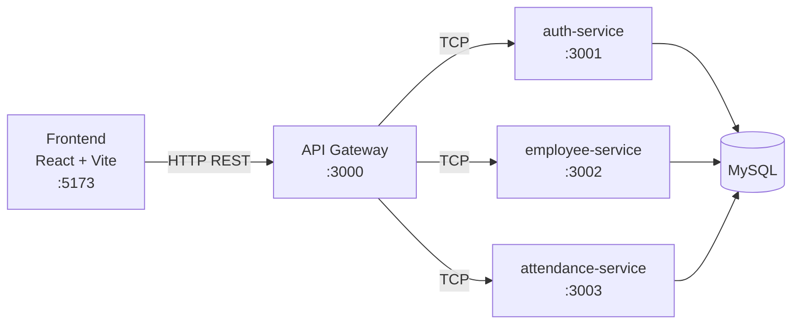

# Absensi WFH

Aplikasi web untuk absensi Work From Home karyawan dan monitoring oleh HRD. Karyawan mencatat kehadiran dengan foto bukti, waktu, dan lokasi. Admin HRD mengelola data master karyawan dan memantau absensi yang masuk (view only).

## Fitur

**Karyawan**
- Login dengan akun yang dibuatkan HRD
- Absen harian dengan foto dari kamera, tanggal dan waktu otomatis (WIB), serta lokasi (GPS dan alamat)
- Foto diberi watermark berisi waktu, tanggal, lokasi, dan email karyawan
- Riwayat absensi pribadi dengan filter rentang tanggal
- Ganti password sendiri

**Admin HRD**
- Dashboard ringkasan: total karyawan aktif, sudah absen, dan belum absen hari ini
- Data karyawan: tambah, lihat, ubah, nonaktifkan, dan hapus
  - Kode karyawan dibuat otomatis (`EMP001`, `EMP002`, ...) dan tidak bisa diubah
  - Password awal dibuat acak oleh sistem dan hanya ditampilkan satu kali
  - Reset password karyawan
  - Karyawan wajib mengganti password sementara saat login pertama kali dan setelah password di-reset
  - Data pribadi: domisili, tempat dan tanggal lahir, gender, status pernikahan, No. KTP, dan No. NPWP
- Monitoring absensi dengan filter tanggal, pencarian nama/kode/email karyawan, dan pagination. Foto bukti baru dimuat saat dibuka (view only)
- Tetap bisa absen untuk dirinya sendiri lewat menu "Absensi Saya"

**Aturan bisnis**
- Satu karyawan hanya bisa absen satu kali per hari (dijaga oleh constraint unik di database)
- Karyawan yang sudah punya riwayat absensi tidak bisa dihapus, hanya dinonaktifkan, supaya riwayatnya tetap tersimpan
- Karyawan nonaktif tidak bisa login
- Admin tidak bisa menghapus, menonaktifkan, atau menurunkan role akunnya sendiri
- Data absensi tidak memiliki endpoint update atau delete sama sekali
- Foto absensi tidak bisa dibuka lewat URL langsung. Foto hanya bisa diakses lewat API dengan login: admin dapat melihat semua foto, sedangkan karyawan hanya fotonya sendiri
- Selama password sementara belum diganti, user hanya bisa membuka halaman Ganti Password. Aturan ini dijaga di frontend (redirect) dan di backend (semua endpoint lain menolak dengan status 403 dan kode `PASSWORD_CHANGE_REQUIRED`)

## Tech Stack

| Bagian | Teknologi |
| --- | --- |
| Backend | NestJS (monorepo, microservices via TCP), TypeScript, TypeORM |
| Database | MySQL |
| Frontend | React, Vite, TypeScript, Tailwind CSS, React Router, Axios |
| PWA | vite-plugin-pwa |
| Autentikasi | JWT, bcrypt |

## Arsitektur



- **api-gateway** adalah satu-satunya service yang menerima HTTP dari frontend. Gateway menangani validasi request, JWT, role, dan upload file, lalu meneruskan perintah ke service terkait lewat TCP.
- **auth-service** mengelola akun login, password, dan role.
- **employee-service** mengelola data master karyawan.
- **attendance-service** mengelola data absensi.

Setiap service hanya mengakses tabelnya sendiri. Kalau butuh data gabungan, misalnya absensi beserta nama karyawan, gateway memanggil beberapa service lalu menggabungkan hasilnya. Service tidak melakukan JOIN ke tabel milik service lain.

Contoh lain: saat admin menambah karyawan, gateway menyimpan data ke employee-service lalu membuat akun di auth-service. Kalau pembuatan akun gagal, data karyawan yang sudah tersimpan dihapus kembali supaya tidak ada data setengah jadi.

## Struktur Folder

```
AbsensiWFH/
├── backend/
│   ├── apps/
│   │   ├── api-gateway/
│   │   ├── auth-service/
│   │   ├── employee-service/
│   │   └── attendance-service/
│   ├── libs/database/        # konfigurasi koneksi MySQL bersama
│   └── uploads/              # foto absensi (tidak di-commit)
├── frontend/
│   └── src/
│       ├── api/              # axios client
│       ├── components/       # komponen custom (Button, Modal, TextField, dll)
│       ├── context/          # AuthContext
│       ├── pages/            # halaman karyawan dan admin
│       └── types/
├── database/
│   └── schema.sql
└── package.json              # script untuk menjalankan backend dan frontend sekaligus
```

## Cara Menjalankan

### Prasyarat

- Node.js versi LTS
- MySQL 8

### 1. Clone repository

```bash
git clone https://github.com/jesselynmu/absensi-wfh.git
cd absensi-wfh
```

### 2. Siapkan database

Jalankan dua file berikut **secara berurutan**:

```bash
mysql -u root -p < database/schema.sql
mysql -u root -p < database/seed.sql
```

- `schema.sql` membuat database `absensi_wfh` beserta tabel-tabelnya.
- `seed.sql` mengisi data awal berupa akun demo (lihat bagian [Akun Demo](#akun-demo)). Semua datanya fiktif.

Kalau memakai MySQL Workbench, DBeaver, atau phpMyAdmin, buka dan jalankan kedua file tersebut dengan urutan yang sama.

### 3. Atur environment

```bash
cp backend/.env.example backend/.env 
cp frontend/.env.example frontend/.env
```

Lalu isi kredensial MySQL di `backend/.env`.

### 4. Install dependency

```bash
npm install
npm install --prefix backend
npm install --prefix frontend
```

### 5. Jalankan

```bash
npm run dev
```

Perintah ini menjalankan keempat service backend dan frontend sekaligus. Tunggu sampai semua service menampilkan pesan "listening", lalu buka http://localhost:5173.

Log gateway mungkin sempat menampilkan error koneksi selama beberapa detik di awal. Itu wajar, karena service lain masih dalam proses compile.

## Akun Demo

Tersedia setelah menjalankan `database/seed.sql`.

| Role | Email | Password | Keterangan |
| --- | --- | --- | --- |
| Admin HRD | admin@company.com | admin123 | |
| Karyawan | budi@company.com | karyawan123 | |
| Karyawan | siti@company.com | karyawan123 | Wajib ganti password saat login, untuk mencoba fitur tersebut |
| Karyawan | andi@company.com | karyawan123 | Nonaktif, untuk mencoba penolakan login |

Akun karyawan baru juga bisa dibuat lewat menu **Data Karyawan**. Password awalnya dibuat acak oleh sistem dan ditampilkan satu kali setelah data disimpan.

## Endpoint API

Dokumentasi interaktif (Swagger) tersedia di **http://localhost:3000/api/docs** saat aplikasi berjalan. Cara mencobanya:

1. Buka bagian **Auth**, jalankan `POST /api/auth/login` dengan akun demo.
2. Salin nilai `accessToken` dari respons.
3. Klik tombol **Authorize** di kanan atas, tempelkan token, lalu klik **Authorize**.
4. Semua endpoint lain sekarang bisa dicoba langsung dari browser.

Base URL: `http://localhost:3000/api`. Semua endpoint selain login membutuhkan header `Authorization: Bearer <token>`.

| Method | Endpoint | Akses | Keterangan |
| --- | --- | --- | --- |
| POST | `/auth/login` | Publik | Login, mengembalikan access token |
| <!-- CEK --> | `/auth/change-password` | Semua | Ganti password sendiri |
| GET | `/employees/me` | Semua | Profil user yang sedang login |
| GET | `/employees?search=&status=&page=&limit=` | Admin | Daftar karyawan dengan pencarian, filter status, dan pagination |
| GET | `/employees/:id` | Admin | Detail karyawan |
| POST | `/employees` | Admin | Tambah karyawan sekaligus akun login |
| PATCH | `/employees/:id` | Admin | Ubah data karyawan |
| DELETE | `/employees/:id` | Admin | Hapus karyawan (hanya jika belum punya riwayat absensi) |
| POST | `/employees/:id/reset-password` | Admin | Buat password sementara baru |
| POST | `/attendances/check-in` | Semua | Absen dengan foto (multipart/form-data) |
| GET | `/attendances/today` | Semua | Status absensi hari ini |
| GET | `/attendances/me?startDate=&endDate=` | Semua | Riwayat absensi sendiri, bisa difilter berdasarkan tanggal |
| GET | `/attendances?startDate=&endDate=&search=&page=&limit=` | Admin | Monitoring semua absensi dengan pagination dan pencarian nama karyawan |
| GET | `/dashboard/summary` | Admin | Ringkasan untuk dashboard |
| GET | `/attendances/:id/photo` | Admin / pemilik | Foto bukti absensi (wajib login) |

## Struktur Database

| Tabel | Pemilik | Isi |
| --- | --- | --- |
| `employees` | employee-service | Data master dan data pribadi karyawan |
| `users` | auth-service | Akun login, password (bcrypt hash), dan role |
| `attendances` | attendance-service | Data absensi, path foto, dan lokasi |

Detail lengkap ada di [`database/schema.sql`](database/schema.sql).

## Rencana Pengembangan

Beberapa hal yang sengaja disederhanakan untuk keperluan technical test, beserta rencana perbaikannya untuk production:

- **Penyimpanan foto di cloud storage.** Saat ini file foto absensi disimpan di disk server (folder `backend/uploads`), dan database hanya menyimpan path-nya. Cara ini dipilih supaya aplikasi bisa langsung dijalankan tanpa akun cloud apa pun. Untuk production, foto sebaiknya dipindah ke object storage seperti **Google Cloud Storage** atau **Amazon S3**, karena:
  - file tetap aman meskipun server diganti atau di-deploy ulang,
  - aplikasi bisa dijalankan di beberapa server sekaligus (horizontal scaling) tanpa masalah file yang hanya ada di satu server,
  - bucket bisa dibuat **private**, lalu foto diakses lewat *signed URL* yang hanya berlaku beberapa menit, sehingga foto karyawan tidak bisa dibuka oleh siapa pun yang sekadar tahu URL-nya.

  Perubahannya cukup di api-gateway (bagian upload). Kolom `photo_path` di database tetap dipakai, hanya isinya berubah dari path lokal menjadi object key di bucket.
- **Database terpisah per service**, sesuai prinsip *database per service* pada microservices. Saat ini ketiga service masih memakai satu database MySQL supaya lebih mudah dijalankan.
- **Message broker** (misalnya RabbitMQ) sebagai pengganti TCP, supaya komunikasi antar service lebih tahan terhadap gangguan.